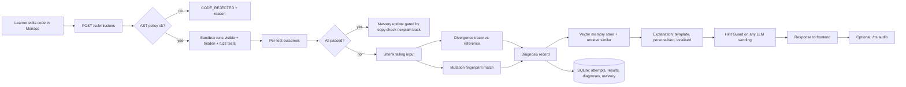
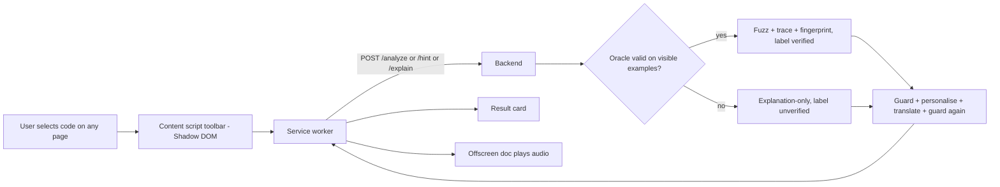
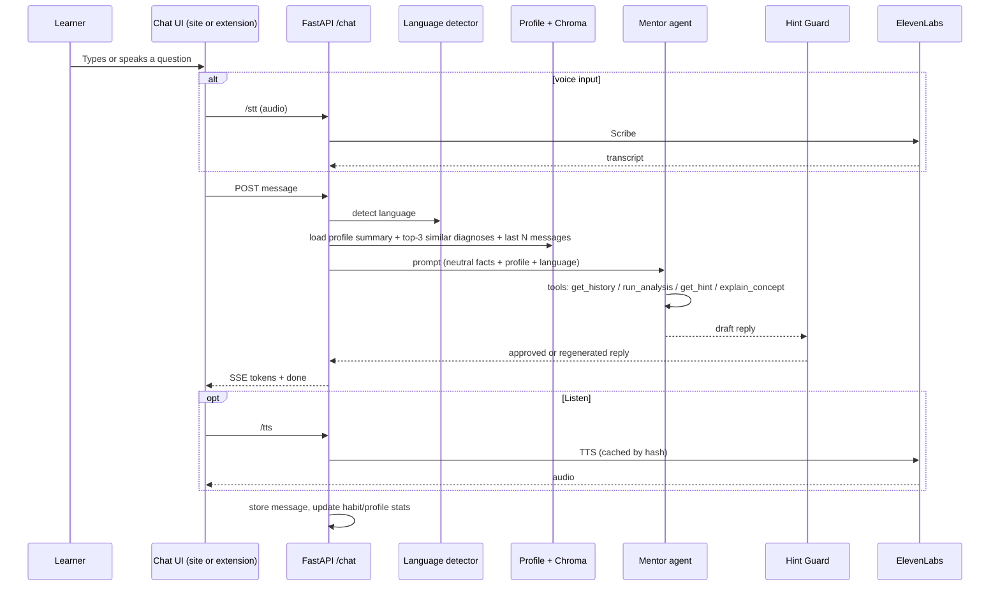
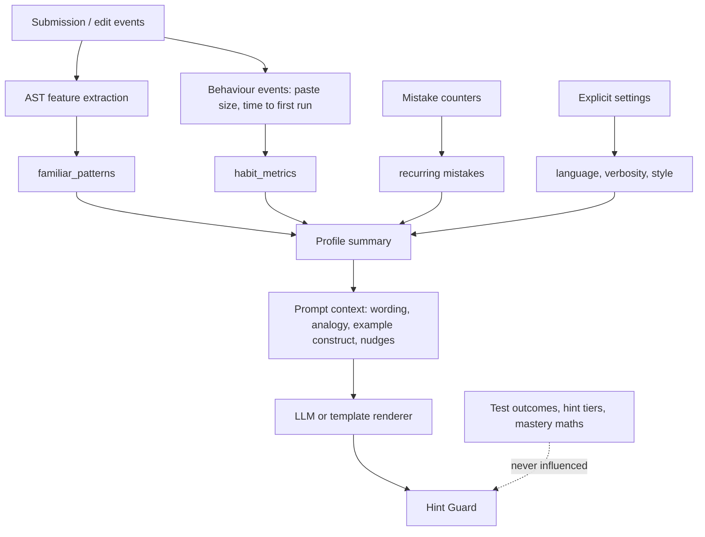
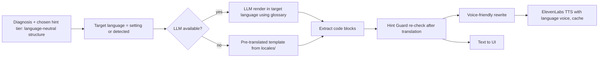
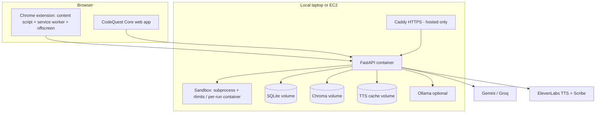

# CodeQuest AI — Complete Project Document

**Event:** VORTEXA 3.0 Hackathon · **Problem Statement:** E-02 (AI Coding Mentor & Debugging Missions) · **Domain:** AI-Powered Education & Learning Technology
**Document version:** 2.0 (adds one-to-one chat, user-specific personalization, multilingual support)
**Team size assumed:** 3–4 people · **Build window:** ~12 hours

> **Items marked `[VERIFY]`** are numbers or product details (ElevenLabs model names, supported languages, credit rates, free-tier limits) that must be checked on the provider dashboard before being relied on.

---

## Table of Contents

1. Project Overview
2. Key Features
3. Unique Selling Points
4. Repository Structure
5. Technology Stack
6. Database Design
7. API Design
8. Datasets and Data Flow
9. External Integrations
10. AI / ML Module
11. Security Architecture
12. Deployment Architecture
13. Scalability Strategy
14. Build Plan, Evidence and Demo
15. Risks, Cut Order and Open Items

---

# 1. Project Overview

## 1.1 Project Name

**CodeQuest AI** — an AI coding mentor and debugging-mission platform. It has two parts that share one backend:

- **CodeQuest Core:** a practice website we own (challenges, sandbox, visible and hidden tests, hints, adaptive learning).
- **CodeQuest Companion:** a Chrome extension (Manifest V3). A learner selects code or text on any tab (LeetCode, GeeksforGeeks, our own site) and gets Hint, Debug, Explain, Concept, Listen and Chat, in text and in voice.

## 1.2 Problem Statement

Beginners learn programming by writing code and reading what goes wrong, but the feedback is hard to use:

- A traceback names an error without explaining it.
- A program can run and still give a wrong answer.
- Pass/fail tools do not show where to look.
- Tools that give full answers too early remove the struggle that makes learning stick, and learners copy complete solutions.
- Running code from an unknown author is dangerous: it can read files, open the network, or exhaust resources.
- Most tools treat every learner the same, ignore the learner's own coding habits, and explain only in English, although many first-year students in India think more easily in Hindi or Marathi.

## 1.3 Target Users

| User | Description | Primary need |
|---|---|---|
| Beginner learner (primary) | First- or second-year student learning Python | Understand *why* code fails, without being handed the answer |
| Regional-language learner | Student more comfortable in Hindi or Marathi than English | Explanations, chat and audio in their language |
| Self-learner on LeetCode / GfG | Practises on third-party platforms | A mentor that works on the page they already use |
| Instructor / judge (secondary) | Reviews progress and verifies integrity of the system | Evidence: diagnosis accuracy, hint-leak rate, sandbox blocks |

## 1.4 Existing Problems (and what current tools do)

| Existing tool behaviour | Gap |
|---|---|
| Online judges report only pass/fail/TLE | No localisation of the bug, no explanation |
| Chatbots (generic LLM) answer with a full solution | Breaks productive struggle; no guarantee a hint is not a solution |
| Learner-code execution on shared servers | Often unrestricted, or opaque to the learner |
| Progress bars and streaks | Do not track *concepts* or *recurring mistakes* |
| Personalisation limited to difficulty | Ignores habits (e.g. always skips empty-input case, pastes large blocks) |
| English-only explanations | Excludes learners who think in Hindi/Marathi |

## 1.5 Proposed Solution

A restricted-execution practice environment plus a mentor layer where **diagnosis is deterministic and the LLM is only used for wording**:

1. Learner code runs only in a sandbox. Each test reports `passed | wrong_output | runtime_error | timeout`; hidden test content is never shown.
2. On failure, a **divergence tracer** runs the reference solution and the learner's code side by side and finds the first step where variable state differs.
3. **Mutation fingerprinting** matches the failure pattern to a known mistake class (off-by-one, missing empty-input check, wrong initial value).
4. A **Hint Guard** enforces four hint tiers and blocks any hint that would reveal a full solution.
5. A **one-to-one mentor chat** lets the learner talk to the mentor privately, by text or voice, within the same guard rules.
6. A **learner profile** (familiar patterns, coding habits, language preference) shapes *how* things are explained, never *whether* a test passes or which hint level is allowed.
7. Everything is available in **English, Hindi and Marathi** (text and ElevenLabs voice).
8. A Chrome extension carries the mentor to any tab. A dashboard shows skill radar, mistake heatmap and recurring-mistake recall.

## 1.6 Expected Impact

| Outcome | How it is measured |
|---|---|
| Learners find bugs faster | Time-to-fix and attempts-to-pass on repeat mistake classes |
| Fewer copied solutions | Share of passes preceded by large paste that are then verified by explain-back |
| Trustworthy mentor | **Hint-leak rate** on a red-team set (target: 0 leaks; report the honest figure) |
| Accurate diagnosis | **Diagnosis accuracy** on ~40 labelled buggy submissions |
| Safe execution | **Attack-block rate** on a set of 5+ attack snippets (target 100%) |
| Language access | Explanation quality score in Hindi/Marathi on a small reviewed sample; share of sessions using non-English |

---

# 2. Key Features

Each feature lists the problem solved, user flow, inputs, outputs and technologies. Features **F-16, F-17, F-18** are the new additions in this version.

## F-01 Restricted Execution Sandbox

| Field | Detail |
|---|---|
| Problem solved | Learner code must not read files, use the network, or consume unlimited CPU/memory |
| User flow | Learner clicks Run/Submit → backend validates code → runs it in an isolated subprocess/container → results shown |
| Inputs | Learner code, challenge id, test set (visible/hidden/fuzzed) |
| Outputs | Per-test outcome list, wall time, resource-limit notes |
| Technologies | Python `subprocess`, `resource.setrlimit`, AST allowlist, Docker (`--network none`) |

Details: `python -I`, empty environment, temp working directory, CPU/memory/file-size/process limits, wall-clock timeout, kill whole process group. AST pre-check allows only `math, collections, heapq, itertools, functools, bisect, typing` and rejects `open, exec, eval, __import__`, and dunder attribute access. On Windows, `resource` is unavailable, so the runner is Docker-only.

## F-02 Per-Test Outcome Reporting with Hidden Tests

| Field | Detail |
|---|---|
| Problem solved | Learners need to see which tests failed without learning hidden test contents |
| User flow | Submit → table of visible tests (input/expected/actual) and hidden tests (outcome class and failure category only) |
| Inputs | Submission, test definitions |
| Outputs | `passed`, `wrong_output`, `runtime_error`, `timeout` per test; for hidden tests only a failure class (e.g. "boundary case") |
| Technologies | FastAPI, sandbox harness, SQLite |

## F-03 Plain-Language Failure Explanation

| Field | Detail |
|---|---|
| Problem solved | Tracebacks and wrong outputs are hard for beginners to interpret |
| User flow | Failure → "Explain" → short explanation in the learner's language, built from deterministic diagnosis, optionally polished by an LLM |
| Inputs | Outcome, traceback, tracer result, mistake class, learner profile |
| Outputs | Explanation text (and optional audio) |
| Technologies | Template engine, LLM wrapper, i18n templates |

## F-04 Tiered Progressive Hints

| Field | Detail |
|---|---|
| Problem solved | Each hint must be more specific than the last, but none may reveal the full solution |
| User flow | Press Hint → receives next allowed tier (concept → location → pattern on different example → gapped pseudocode) |
| Inputs | User id, problem id, code, attempt count, elapsed time |
| Outputs | Hint level, hint text, guard report (passed, retries) |
| Technologies | Hint Guard module, LLM, SQLite (unlock state) |

## F-05 Hint Guard (enforced hint safety)

| Field | Detail |
|---|---|
| Problem solved | "No hint may reveal the complete solution, including AI-generated hints" must be enforced, not hoped for |
| User flow | Invisible to the learner; visible to judges through a red-team panel |
| Inputs | Candidate hint text |
| Outputs | Approved hint, or regenerated/template hint; leak statistics |
| Technologies | Code-block extraction, sandbox re-execution, AST similarity, regex checks |

Checks: (1) extract code from the hint and run it against tests, block if it passes; (2) AST similarity to the reference above threshold → block; (3) full function definition at tier ≤ 3 → block; (4) up to 2 regeneration tries with stricter prompt, then a template hint.

## F-06 Divergence Tracer

| Field | Detail |
|---|---|
| Problem solved | Pinpoints *where* learner code departs from correct behaviour |
| User flow | Debug → "On iteration 3, `total` is 7 expected and 5 in yours (line 6)" plus a step-through panel |
| Inputs | Learner code, reference solution, minimal failing input |
| Outputs | First divergence step, variable states, line number |
| Technologies | `sys.settrace`, locals snapshots, name-based alignment |

## F-07 Mutation Fingerprinting (mistake diagnosis)

| Field | Detail |
|---|---|
| Problem solved | Identifies *which kind* of mistake the learner made, explainably and without an LLM |
| User flow | Submission fails → "Your code behaves like a loop-bound off-by-one" |
| Inputs | Learner's pass/fail vector over a fixed fuzz set |
| Outputs | Mistake class, similarity confidence, or "no known pattern" |
| Technologies | AST mutation operators, Hamming distance, SQLite cache |

## F-08 Fuzzed Hidden Tests and Hardcode Detector

| Field | Detail |
|---|---|
| Problem solved | Prevents memorising or leaking hidden tests; catches `if input == X: return Y` |
| User flow | Each attempt gets freshly seeded fuzz inputs compared against the reference; hardcoding is flagged |
| Inputs | Signature-driven random generators, reference solution |
| Outputs | Failure class only; hardcode flag |
| Technologies | Differential fuzzing, shrinker, AST pattern checks |

## F-09 Effort-Aware Hint Unlocking and Copy Detection

| Field | Detail |
|---|---|
| Problem solved | Learners click through hints or paste complete solutions |
| User flow | Hints unlock by attempts and time spent; large paste followed by a pass triggers an explain-back request |
| Inputs | Edit events (paste size, timing), attempts |
| Outputs | Unlock state, "explain this code" prompt, mastery gating |
| Technologies | Editor event tracking, SQLite |

## F-10 Adaptive Learning Model

| Field | Detail |
|---|---|
| Problem solved | Future challenges must adapt to recurring mistakes and per-concept skill |
| User flow | After each attempt, mastery updates; next challenge targets the weakest concept; mentor says "same boundary issue as in Challenge 3" |
| Inputs | Outcomes, mistake class, difficulty |
| Outputs | Concept mastery scores, next-challenge recommendation, skill radar, mistake heatmap |
| Technologies | Elo-style/BKT update, SQLite |

## F-11 Voice Output (Listen)

| Field | Detail |
|---|---|
| Problem solved | Learners debug more easily by listening, especially in their own language |
| User flow | Click Listen on any approved explanation/hint/chat reply → audio plays |
| Inputs | Guard-approved text, language |
| Outputs | MP3 audio (cached), cache hit/miss header |
| Technologies | ElevenLabs TTS, disk cache keyed by `sha256(text|voice|lang|model)`, browser `speechSynthesis` fallback |

Only finished, guard-approved text is spoken. A voice-friendly rewrite converts symbols ("<=" → "less than or equal to").

## F-12 Explain-Back (Rubber-Duck Mode)

| Field | Detail |
|---|---|
| Problem solved | Proves the learner understands the fix, not just that code passes |
| User flow | After a fix, learner speaks the explanation → transcribed → scored against a rubric → mastery updates only if it passes |
| Inputs | Audio, diagnosis rubric |
| Outputs | Transcript, score, feedback |
| Technologies | ElevenLabs Scribe (STT), LLM scoring with rubric |

## F-13 Chrome Extension Companion

| Field | Detail |
|---|---|
| Problem solved | The mentor should follow the learner to the platforms they already use |
| User flow | Select code/text on any tab → floating toolbar (Hint, Debug, Explain, Concept, Listen, Chat) → result card |
| Inputs | Selected code, visible problem statement (from page), action |
| Outputs | Verdict, trace, hint ladder, audio |
| Technologies | MV3, content script in Shadow DOM, service worker, offscreen audio document, React popup |

Extension holds **no logic and no API keys**; every call goes through the service worker to the backend.

## F-14 Oracle Verification for Foreign Problems

| Field | Detail |
|---|---|
| Problem solved | On third-party pages we do not own tests or reference solutions |
| User flow | Backend asks an LLM for a brute-force reference, validates it on the page's visible examples, then fuzzes the learner's code against it |
| Inputs | Problem text, signature, examples |
| Outputs | Result labelled `oracle-verified` or `unverified` |
| Technologies | LLM, sandbox, differential fuzzing |

If the oracle fails the visible examples, the system falls back to explanation-only mode and says so.

## F-15 Dashboard and Per-User Memory

| Field | Detail |
|---|---|
| Problem solved | Learners need to see progress and recurring mistakes |
| User flow | Open popup/dashboard → radar, heatmap, recent diagnoses with "seen before" links, credit meter, verified/unverified breakdown |
| Inputs | User id |
| Outputs | Mastery, mistakes, recent diagnoses |
| Technologies | React, Recharts, SQLite, Chroma (vector memory) |

## F-16 One-to-One Mentor Chat *(new)*

| Field | Detail |
|---|---|
| Problem solved | Learners have follow-up questions ("why is `range(n-1)` wrong?") that one-shot buttons cannot handle; a private 1:1 conversation keeps context and builds trust |
| Scope | One learner ↔ one AI mentor, private to that learner. Threads are per learner and optionally attached to a problem. No group chat, no sharing between users |
| User flow | Open Chat (site panel, extension side panel, or voice button) → type or speak a question → mentor replies in streaming text and optional audio → conversation history persists across sessions |
| Inputs | Message text or audio, thread id (optional), current code/problem context (optional), user id |
| Outputs | Streamed reply, guard report, optional audio, updated thread |
| Technologies | FastAPI SSE, SQLite (threads, messages), Chroma retrieval, Hint Guard, ElevenLabs STT/TTS |

Rules for the chat:

1. Every assistant message passes through **Hint Guard**. If the learner asks "just give me the answer", the mentor declines kindly and offers the next allowed hint tier.
2. Chat can call only a restricted tool set: `get_history`, `run_analysis`, `get_hint(level)`, `explain_concept`. It cannot output unguarded code.
3. Context window = last N messages + profile summary + top-3 retrieved past diagnoses.
4. Messages are language-aware (see F-18): user writes in Marathi, mentor answers in Marathi.
5. Learner can delete a thread or all history at any time.
6. If the LLM is unavailable, chat degrades to a **rule-based mode**: intent matching (hint / explain / concept / progress) answered from templates and diagnosis data.

*Assumption:* "one-to-one chat" means learner ↔ AI mentor. If a human mentor-to-learner channel is also wanted, the same `chat_threads` table supports it by adding a `participant_type` column (see section 6) — marked as a post-hackathon extension.

## F-17 User-Specific Answers: Familiar Patterns, Coding Habits, Language *(new)*

| Field | Detail |
|---|---|
| Problem solved | Generic explanations ignore who is asking. A learner who thinks in dictionaries should get dictionary analogies; one who always forgets empty input should be reminded early |
| User flow | Learner sets preferences (programming language, natural language, verbosity, explanation style) once → system also learns habits from submissions → every explanation, hint wording and chat reply is tailored |
| Inputs | Explicit settings; code submissions (AST features); edit events; mistake history; past explanations that worked |
| Outputs | Learner profile; tailored wording, analogies, example choice, ordering of advice |
| Technologies | AST feature extraction, SQLite profile tables, Chroma memory, prompt templating |

What the profile contains:

| Profile dimension | How it is learned | How it is used |
|---|---|---|
| **Familiar patterns** | AST counts of constructs used successfully (for-loops vs comprehensions, dict/set usage, recursion, two-pointer, sorting) | Pick analogies and examples in constructs the learner already knows; avoid unfamiliar ones at early hint tiers |
| **Coding habits** | Naming style (single-letter vs descriptive), comment density, function length, tendency to skip edge cases, paste frequency, time-to-first-run, run-before-think ratio | Targeted nudges ("you often skip the empty list; check it first"), pacing of hints, copy-detection sensitivity |
| **Recurring mistakes** | Mistake-class counters + vector recall | "Same boundary issue as in Two Sum" |
| **Language (programming)** | Explicit setting (Python for challenges; Java/C++/JS recognised in extension for explanation only) | Syntax of examples |
| **Language (natural)** | Explicit setting + detection (see F-18) | Language of all outputs |
| **Explanation style** | Explicit: short / detailed, analogy / formal; implicit: which explanations led to a pass on the next attempt | Verbosity and tone |

**Hard rule:** personalisation may change *wording, analogies, example selection and nudges*. It may **never** change test outcomes, hint-tier eligibility, guard thresholds or mastery maths. This keeps the system checkable.

**Privacy controls:** profile is viewable, editable and deletable by the learner; stored locally keyed by a generated user id; no accounts or emails required.

## F-18 Multilingual Support *(new)*

| Field | Detail |
|---|---|
| Problem solved | Many learners understand concepts faster in Hindi or Marathi; English-only mentors exclude them |
| Languages | **English, Hindi, Marathi** in the first release (extendable: any language the LLM and ElevenLabs support) `[VERIFY ElevenLabs voice/model support for Marathi]` |
| User flow | Choose language (or let it auto-detect) → UI labels, explanations, hints, chat and audio all appear in that language; code and technical identifiers stay in English |
| Inputs | Preferred language, detected language of the learner's message, voice id per language |
| Outputs | Localised UI, localised explanations/hints/chat, localised audio, localised voice input transcript |
| Technologies | i18next (UI strings), language detection, LLM translation with a glossary, ElevenLabs multilingual TTS and Scribe |

How multilingual works safely:

1. **Diagnosis and guard run on language-neutral structured data** (mistake class, tier, tracer step). Wording in the target language is generated *after* that.
2. **Guard runs again after translation** on extracted code blocks, so translation cannot smuggle in a solution.
3. **Glossary:** terms like `loop`, `index`, `array`, `variable` stay in English or appear as "लूप (loop)" so learners can map to documentation.
4. **Code, identifiers, error names (`IndexError`) are never translated.**
5. **Detection:** Unicode script check separates Latin from Devanagari. Hindi vs Marathi (both Devanagari) is decided by the user's setting first, then by a small stop-word heuristic (e.g. Marathi "आहे/होते/मला", Hindi "है/था/मुझे").
6. **Code-mixed input** ("mala loop madhe error yet ahe") is handled by the LLM; reply follows the dominant language of the user's *setting*.
7. **No-LLM fallback:** template explanations are pre-translated for the 3 languages, so non-English still works offline.
8. **Voice:** Scribe transcribes in the chosen language; TTS uses a per-language voice. If voice fails, browser `speechSynthesis` is used.

---

# 3. Unique Selling Points (USP)

These are features too, but they are what separates CodeQuest AI from typical "run tests, call an LLM, show a progress bar" submissions.

| # | USP | Why it is different / real-world applicability | AI capabilities | Future readiness | Competitive advantage |
|---|---|---|---|---|---|
| 1 | **Divergence Tracer** | Deterministic bug localisation: shows the first step where learner state differs from the reference. Mirrors how experienced developers debug | AI is not needed for localisation; LLM only words the result | Extensible to other languages with a tracing hook | Most teams guess with an LLM; this is verifiable |
| 2 | **Mutation Fingerprinting** | Recurring-mistake detection that is explainable and works with zero LLM calls | Optional LLM to polish text | Mutant library grows per problem; can feed class-wide analytics | Provides "diagnosis accuracy" numbers judges can trust |
| 3 | **Hint Guard** | Enforces "no hint reveals the solution" by execution and AST checks, including AI hints | LLM generates, guard verifies | Same pattern applies to any AI tutor | Red-team demo with an honest leak rate |
| 4 | **Visible Sandbox Attack Set** | Attack snippets (`/etc/passwd`, socket, fork bomb, `while True`, 5 GB alloc) each shown blocked with a reason | None | Container hardening scales to hosted use | Safety is demonstrated, not claimed |
| 5 | **Fuzzed Hidden Tests + Hardcode Detector** | Hidden tests cannot be memorised or leaked | None | Per-attempt seeds enable fair assessments | Catches cheating most platforms miss |
| 6 | **Explain-Back Gating** | Mastery only updates if the learner explains the fix aloud; targets copy-paste learning | STT + rubric-scoring LLM | Can become oral-assessment support | Voice has a real job, not decoration |
| 7 | **One-to-One Private Mentor Chat with Guarded Tools** *(new)* | A conversational mentor that cannot leak solutions because every reply passes the guard | LLM agent with 4 restricted tools | Add human-mentor handoff | Chat is safe by construction |
| 8 | **Habit- and Pattern-Aware Personalisation** *(new)* | Explanations use constructs the learner already knows and warn about *their* habits | AST-derived profile + vector memory | Profile can drive instructor reports | Personalisation that cannot alter grading |
| 9 | **Trilingual Mentor (EN/HI/MR) with Guard-After-Translate** *(new)* | Real inclusion for regional-language learners; text and voice | LLM translation with glossary; multilingual TTS/STT | New languages by adding a locale pack + voice | Few hackathon tools handle Devanagari voice + code-safe translation |
| 10 | **Extension on Any Tab, Oracle-Verified/Unverified Labels** | Works where learners already practise, and is honest about what it can verify | LLM-written oracle validated against visible examples | Add more sites by selector config | Trust through transparent labelling |
| 11 | **Per-User Vector Memory** | "Same mistake as in Two Sum last Tuesday" | Embeddings (MiniLM) + retrieval | Cross-device sync | Memory shapes style but cannot change outcomes |
| 12 | **No-LLM Fallback** | Product still works if the API dies mid-demo | Template engine | Offline classroom use | Meets "core demo must not depend on external services" |
| 13 | **Credit-Aware ElevenLabs Usage** | Cache, credit meter, pre-rendered demo audio | n/a | Cost-controlled scaling | Efficient use of the 131K free credits `[VERIFY]` |


---

# 4. Repository Structure

```
codequest-ai/
├── README.md                        # 3-step install: start backend, load unpacked extension, configure
├── docker-compose.yml               # One-command local run (backend + volume)
├── .env.example                     # Placeholder keys: ELEVENLABS_API_KEY, LLM_API_KEY, API_TOKEN (never commit real .env)
├── openapi.yaml                     # API contract; written first so frontend can mock it
├── docs/
│   ├── architecture.md              # Diagrams and design decisions
│   ├── privacy-policy.md            # What data is stored (code, profile, audio) and how to delete it
│   ├── evidence/                    # Labelled results shown to judges
│   │   ├── diagnosis_accuracy.md    # Results on ~40 labelled buggy submissions
│   │   ├── hint_leak_report.md      # Red-team prompts and measured leak rate
│   │   ├── sandbox_attacks.md       # Attack snippets and block reasons
│   │   └── multilingual_eval.md     # Reviewed sample of HI/MR explanations
│   └── demo_script.md               # ~4 minute demo flow
│
├── backend/
│   ├── Dockerfile                   # Python slim; model baked in at build time
│   ├── requirements.txt             # Pinned dependencies
│   ├── app/
│   │   ├── main.py                  # FastAPI app, CORS allowlist (chrome-extension://<id>), router mounting
│   │   ├── config.py                # Settings loaded from environment
│   │   ├── deps.py                  # Auth (API token), rate limiting, DB session
│   │   ├── routers/                 # One file per API group
│   │   │   ├── health.py            # /health
│   │   │   ├── users.py             # user creation, settings, profile, data deletion
│   │   │   ├── challenges.py        # list/get challenges, visible tests
│   │   │   ├── submissions.py       # run/submit code
│   │   │   ├── analyze.py           # extension analysis (oracle + fuzz + trace + mutant match)
│   │   │   ├── hints.py             # tiered hints
│   │   │   ├── explain.py           # debug / explain / concept
│   │   │   ├── chat.py              # one-to-one chat threads and messages (SSE)
│   │   │   ├── voice.py             # /tts, /stt, credit meter
│   │   │   ├── explainback.py       # spoken explanation scoring
│   │   │   └── dashboard.py         # mastery, mistakes, recent diagnoses
│   │   ├── sandbox/
│   │   │   ├── runner.py            # Subprocess/Docker execution with limits
│   │   │   ├── harness.py           # Wraps learner function, calls with test inputs, emits JSON
│   │   │   ├── ast_policy.py        # Import allowlist and banned constructs
│   │   │   └── attacks/             # Attack snippets used in the visible attack demo
│   │   ├── oracle/
│   │   │   ├── oracle_gen.py        # LLM brute-force reference + validation on examples
│   │   │   ├── generators.py        # Type-driven input generators (edge-biased)
│   │   │   ├── fuzzer.py            # Differential fuzzing against reference
│   │   │   └── shrinker.py          # Minimises first mismatch to smallest failing input
│   │   ├── tracer/
│   │   │   ├── trace_runner.py      # sys.settrace recording (line, locals) per step
│   │   │   └── divergence.py        # Aligns two traces, finds first differing shared variable
│   │   ├── mutants/
│   │   │   ├── operators.py         # AST mutation operators (<→<=, range off-by-one, init change...)
│   │   │   ├── fingerprint.py       # Builds and stores mutant pass/fail vectors
│   │   │   └── matcher.py           # Nearest fingerprint by Hamming distance
│   │   ├── guard/
│   │   │   ├── hint_guard.py        # Checks: run extracted code, AST similarity, function-def regex
│   │   │   ├── tiers.py             # 4 hint tiers and unlock rules (attempts + time)
│   │   │   ├── hardcode_detector.py # Flags `if input == X: return Y` patterns
│   │   │   └── copy_detector.py     # Large-paste detection → explain-back requirement
│   │   ├── agent/
│   │   │   ├── mentor_agent.py      # Tool-using agent (get_history, run_analysis, get_hint, explain_concept)
│   │   │   ├── tools.py             # Tool implementations; hints always wrapped by guard
│   │   │   ├── chat_service.py      # Thread handling, context assembly, streaming
│   │   │   └── rule_based_chat.py   # No-LLM fallback: intent match + templates
│   │   ├── personalization/
│   │   │   ├── ast_features.py      # Extracts construct usage and style metrics from code
│   │   │   ├── habit_tracker.py     # Paste size, timing, edge-case skipping, run-before-think
│   │   │   ├── profile_service.py   # Builds profile summary for prompts
│   │   │   └── style_adapter.py     # Chooses analogy, verbosity and example constructs
│   │   ├── i18n/
│   │   │   ├── detect.py            # Script + stop-word language detection (en/hi/mr)
│   │   │   ├── glossary.json        # Terms kept in English or bilingual
│   │   │   ├── translate.py         # LLM translation with glossary; re-runs guard after
│   │   │   ├── voice_text.py        # Voice-friendly rewrite (symbols → words)
│   │   │   └── locales/             # Pre-translated templates for no-LLM mode
│   │   │       ├── en.json
│   │   │       ├── hi.json
│   │   │       └── mr.json
│   │   ├── voice/
│   │   │   ├── elevenlabs_client.py # TTS and Scribe calls, credit counting
│   │   │   ├── cache.py             # Disk cache keyed by sha256(text|voice|lang|model)
│   │   │   └── voices.py            # Voice id per language
│   │   ├── llm/
│   │   │   ├── client.py            # Single llm.complete() entry; Gemini/Groq/Ollama swap
│   │   │   └── prompts/             # Prompt templates (explain, hint, chat, rubric, translate)
│   │   ├── memory/
│   │   │   ├── embeddings.py        # all-MiniLM-L6-v2 loader (baked into image)
│   │   │   └── vector_store.py      # Chroma: store/retrieve diagnoses per user
│   │   ├── adaptive/
│   │   │   ├── mastery.py           # Elo/BKT-style per-concept update
│   │   │   └── recommender.py       # Picks next challenge for weakest concept
│   │   ├── db/
│   │   │   ├── models.py            # SQLAlchemy models
│   │   │   ├── schema.sql           # Reference DDL (section 6)
│   │   │   └── seed.py              # Loads challenges, tests, concepts, mistake classes
│   │   └── schemas/                 # Pydantic request/response models and validation
│   └── tests/
│       ├── test_sandbox_attacks.py  # Every attack snippet must be blocked
│       ├── test_guard_redteam.py    # Red-team prompts → leak rate
│       ├── test_diagnosis_labeled.py# ~40 labelled buggy submissions → accuracy
│       ├── test_language_detect.py  # en/hi/mr/code-mixed samples
│       └── test_chat_guard.py       # Chat cannot emit unguarded solutions
│
├── challenges/                      # Our own content (no scraped data)
│   ├── 01_sum_even/                 # One folder per challenge
│   │   ├── meta.json                # Title, difficulty, concepts, signature
│   │   ├── description.md           # Problem text (en); hi/mr in description.hi.md, description.mr.md
│   │   ├── starter.py               # Starter code
│   │   ├── reference.py             # Reference solution (never sent to client)
│   │   ├── visible_tests.json       # Shown to learner
│   │   └── hidden_tests.json        # Never exposed; plus fuzz config
│   └── ...                          # 8–10 challenges
│
├── web/                             # CodeQuest Core site
│   ├── package.json
│   ├── vite.config.ts
│   └── src/
│       ├── pages/                   # Challenge list, Challenge (editor + results), Dashboard, Settings, Chat
│       ├── components/              # Monaco editor, TestResultTable, HintLadder, TracePanel, ChatPanel, LanguageSwitcher
│       ├── i18n/                    # i18next setup + en/hi/mr UI strings
│       └── api/                     # Typed client generated from openapi.yaml
│
├── extension/                       # CodeQuest Companion (MV3)
│   ├── manifest.json                # MV3, fixed "key" so extension ID never changes, host_permissions
│   ├── vite.config.ts               # @crxjs/vite-plugin build
│   └── src/
│       ├── content/
│       │   ├── toolbar.ts           # Shadow DOM floating toolbar on text selection
│       │   ├── page_context.ts      # Reads visible problem statement (selectors in config)
│       │   └── selectors.config.ts  # Per-site selectors with 2 fallbacks
│       ├── background/
│       │   ├── service_worker.ts    # All network calls, context menu, settings, token
│       │   └── offscreen.ts         # Audio playback (reason AUDIO_PLAYBACK)
│       ├── offscreen.html           # Offscreen document host
│       ├── panel/                   # Result card and chat side panel (React)
│       ├── popup/                   # Dashboard popup (radar, heatmap, credits)
│       ├── options/                 # Backend URL (localhost/hosted), language, voice, token
│       └── i18n/                    # Same locale files as web
│
├── deploy/
│   ├── Caddyfile                    # HTTPS reverse proxy for hosted backup
│   ├── ec2-setup.sh                 # Docker install + compose up on a fresh instance
│   └── hardening.md                 # No egress, non-root, read-only FS, limits
│
└── scripts/
    ├── build_extension_zip.sh       # vite build → zip contents of dist/ (manifest at zip root)
    ├── prerender_demo_audio.py      # Pre-generates demo audio into cache (EN/HI/MR)
    └── generate_mutants.py          # Pre-builds mutant fingerprints for all challenges
```

---

# 5. Technology Stack

Only technologies used by the project are listed.

## 5.1 Backend

| Layer | Technology | Purpose |
|---|---|---|
| Language | Python 3.11 | Backend, sandbox harness, tracer |
| Framework | FastAPI + Uvicorn | REST API, SSE streaming |
| Validation | Pydantic | Request/response validation |
| ORM | SQLAlchemy | DB access |
| Database | SQLite | Attempts, mastery, profile, chat, caches |
| Vector store | Chroma | Per-user diagnosis memory |
| Embeddings | `all-MiniLM-L6-v2` (sentence-transformers) | Local embeddings, no paid API |
| LLM | Gemini free tier or Groq; Ollama local fallback | Wording, oracle, chat, translation, rubric scoring |
| Voice | ElevenLabs TTS + Scribe | Audio output and spoken explain-back |
| Language detection | Script check + stop-word heuristic (optional `langdetect`) | Detect en/hi/mr |
| Container | Docker + Compose | Packaging and sandbox hardening |

## 5.2 Frontend (Core site)

| Layer | Technology | Purpose |
|---|---|---|
| Framework | React + Vite + TypeScript | UI |
| Styling | Tailwind CSS | Fast, consistent UI |
| Editor | Monaco Editor | Code editing and paste events |
| Charts | Recharts | Skill radar, mistake heatmap |
| i18n | i18next + react-i18next | UI in en/hi/mr |

## 5.3 Extension

| Layer | Technology | Purpose |
|---|---|---|
| Platform | Chrome Manifest V3 | Extension runtime |
| Build | `@crxjs/vite-plugin` | MV3 bundling with HMR |
| UI | React (panel/popup), Shadow DOM (toolbar) | Isolated styling from host pages |
| Audio | Offscreen document | Service workers cannot play audio |

## 5.4 DevOps

| Area | Technology |
|---|---|
| Local run | `docker compose up` |
| Hosted backup | AWS EC2 (or tunnel) + Caddy for HTTPS |
| Distribution | Zip of `dist/` on a GitHub Release (load-unpacked) |

## 5.5 New / Complex Technologies Explained

### a) `sys.settrace` (Python execution tracing)
Python lets you register a function that is called on every line, call and return. We use it to record `(line number, snapshot of local variables)` at each step for both the reference and the learner code on the same failing input. Aligning the two recordings by shared variable names shows the first step where values differ. Caveats: tracing slows execution (so we cap steps), and variable names must overlap between solutions; if they do not, we fall back to comparing final output and loop iteration counts.

### b) AST mutation (mutation testing)
The Abstract Syntax Tree (AST) is Python's parsed representation of code. We apply small deliberate changes to the reference solution (e.g. `<` to `<=`, `range(n)` to `range(n-1)`), creating "mutants" that mimic common beginner bugs. Each mutant is run on a fixed fuzz set, giving a pass/fail vector (its **fingerprint**) labelled with a mistake class. A learner's submission produces its own vector on the same set; the nearest fingerprint by **Hamming distance** (count of differing positions) names the likely mistake.

### c) Differential fuzzing with shrinking
Generate many random inputs (biased toward edge cases: empty, single element, duplicates, negatives, large), run both reference and learner, and find mismatches. **Shrinking** repeatedly simplifies the failing input (drop elements, reduce values) while it still fails, producing the smallest, most understandable counterexample.

### d) Hint Guard (execution-based leak detection)
Instead of trusting a prompt that says "do not reveal the answer", the guard extracts any code from a candidate hint, executes it against tests, compares its AST to the reference, and rejects it if it solves the problem or closely resembles the solution. This turns a policy into a measurable test.

### e) Chrome MV3 service worker + offscreen document
In Manifest V3, background logic runs in a short-lived service worker with no DOM and no audio. All backend calls (so API keys and CORS issues stay out of web pages) go through it. Audio playback is delegated to an **offscreen document** created with reason `AUDIO_PLAYBACK`. Playback must start from a user gesture (the toolbar click) to avoid autoplay blocking.

### f) Shadow DOM toolbar
The floating toolbar is rendered inside a Shadow DOM so the host page's CSS (LeetCode etc.) cannot restyle or break it.

### g) Vector memory (Chroma + MiniLM)
Each diagnosis (problem title, mistake class, divergence summary) is converted to a vector. On a new failure we retrieve the nearest past diagnoses to say "same mistake as before" and to pick analogies that worked. It influences wording only.

### h) Elo / Bayesian Knowledge Tracing (BKT)
Statistical models that estimate skill per concept from pass/fail outcomes. We use an Elo-style update weighted by problem difficulty: success against a hard problem raises mastery more than success on an easy one.

### i) ElevenLabs Scribe and multilingual TTS
Scribe converts speech to text (used for explain-back and voice chat); TTS converts guard-approved text to speech. Both are called only from the backend, with a disk cache keyed by `sha256(text|voice|lang|model)` and a credit meter. `[VERIFY model names, language coverage and credit rates on the dashboard]`

### j) Server-Sent Events (SSE)
One-way streaming from server to browser over HTTP, used so chat and explanations appear token by token. Simpler than WebSockets for this use case.

### k) AST-based habit extraction *(new)*
For personalisation we parse each submission and count constructs (for-loops, comprehensions, dict/set usage, recursion), measure style (name length, comments per line, function length) and record behaviour (paste size, time to first run). These are deterministic features; no LLM is needed to build the profile.

---

# 6. Database Design

**Engine:** SQLite (file on a mounted volume). Chroma holds vectors separately; its ids are referenced from SQLite. Timestamps are ISO-8601 UTC text. Booleans are `INTEGER` 0/1. Foreign keys are enabled with `PRAGMA foreign_keys=ON`.

## 6.1 Entity Relationship Overview

```
users 1──1 user_settings
users 1──1 user_profiles
users 1──* habit_events
users 1──* attempts *──1 challenges
attempts 1──* test_results *──1 tests
attempts 1──0..1 diagnoses *──1 mistake_classes
users 1──* concept_mastery *──1 concepts
challenges *──* concepts            (challenge_concepts)
challenges 1──* mutants *──1 mistake_classes
users 1──* hint_state *──1 challenges
hint_state 1──* hints_issued
users 1──* explainbacks
users 1──* chat_threads 1──* chat_messages
users 1──* voice_usage
tts_cache (global, keyed by hash)
glossary_terms (global)
api_tokens
redteam_runs
```

## 6.2 Tables

### users
| Column | Type | Constraints |
|---|---|---|
| id | TEXT | **PK**, generated UUID |
| created_at | TEXT | NOT NULL |
| last_seen_at | TEXT | |
| deleted_at | TEXT | NULL unless erased |

Indexes: PK only.

### user_settings
| Column | Type | Constraints |
|---|---|---|
| user_id | TEXT | **PK**, **FK → users.id** ON DELETE CASCADE |
| ui_language | TEXT | NOT NULL DEFAULT 'en', CHECK IN ('en','hi','mr') |
| mentor_language | TEXT | NOT NULL DEFAULT 'en', CHECK IN ('en','hi','mr') |
| auto_detect_language | INTEGER | NOT NULL DEFAULT 1 |
| programming_language | TEXT | NOT NULL DEFAULT 'python' |
| verbosity | TEXT | NOT NULL DEFAULT 'short', CHECK IN ('short','detailed') |
| explanation_style | TEXT | NOT NULL DEFAULT 'analogy', CHECK IN ('analogy','formal') |
| voice_enabled | INTEGER | NOT NULL DEFAULT 1 |
| voice_id_override | TEXT | |
| memory_enabled | INTEGER | NOT NULL DEFAULT 1 |

Relationship: 1:1 with users.

### user_profiles
| Column | Type | Constraints |
|---|---|---|
| user_id | TEXT | **PK**, **FK → users.id** CASCADE |
| familiar_patterns | TEXT | JSON: `{"for_loop":12,"dict":7,"recursion":0,...}` |
| habit_metrics | TEXT | JSON: avg name length, comment density, avg function length, edge-case skip rate, paste rate, run-before-think ratio |
| preferred_analogies | TEXT | JSON list of analogy tags that preceded a pass |
| summary_text | TEXT | Short prompt-ready summary, regenerated periodically |
| updated_at | TEXT | NOT NULL |

### habit_events
| Column | Type | Constraints |
|---|---|---|
| id | INTEGER | **PK** AUTOINCREMENT |
| user_id | TEXT | NOT NULL **FK → users.id** CASCADE |
| attempt_id | INTEGER | **FK → attempts.id** SET NULL |
| event_type | TEXT | NOT NULL, CHECK IN ('paste','first_run','edit_burst','run','hint_request') |
| value | REAL | e.g. paste size in chars, seconds |
| created_at | TEXT | NOT NULL |

Indexes: `idx_habit_user_time (user_id, created_at)`.

### challenges
| Column | Type | Constraints |
|---|---|---|
| id | TEXT | **PK** (e.g. 'sum_even') |
| title | TEXT | NOT NULL |
| difficulty | INTEGER | NOT NULL CHECK 1–5 |
| signature | TEXT | NOT NULL |
| description_en / description_hi / description_mr | TEXT | NOT NULL for en; hi/mr nullable |
| starter_code | TEXT | NOT NULL |
| reference_path | TEXT | NOT NULL (server-side only) |
| is_foreign | INTEGER | NOT NULL DEFAULT 0 (1 = page-derived from extension, not stored content) |

### concepts
| Column | Type | Constraints |
|---|---|---|
| id | TEXT | **PK** (e.g. 'loops','boundaries','hashmap') |
| name_en / name_hi / name_mr | TEXT | name_en NOT NULL |

### challenge_concepts
| Column | Type | Constraints |
|---|---|---|
| challenge_id | TEXT | **FK → challenges.id** CASCADE |
| concept_id | TEXT | **FK → concepts.id** CASCADE |
| | | **PK (challenge_id, concept_id)** |

### tests
| Column | Type | Constraints |
|---|---|---|
| id | INTEGER | **PK** |
| challenge_id | TEXT | NOT NULL **FK → challenges.id** CASCADE |
| kind | TEXT | NOT NULL CHECK IN ('visible','hidden') |
| input_json | TEXT | NOT NULL |
| expected_json | TEXT | NOT NULL |
| failure_category | TEXT | e.g. 'empty','boundary','duplicates' (the only thing shown for hidden) |

Indexes: `idx_tests_challenge (challenge_id, kind)`.

### attempts
| Column | Type | Constraints |
|---|---|---|
| id | INTEGER | **PK** AUTOINCREMENT |
| user_id | TEXT | NOT NULL **FK → users.id** CASCADE |
| challenge_id | TEXT | **FK → challenges.id** (NULL for foreign problems) |
| foreign_problem_hash | TEXT | sha256 of problem text when foreign |
| code | TEXT | NOT NULL |
| verified | INTEGER | NOT NULL DEFAULT 1 (0 = oracle unverified) |
| overall | TEXT | CHECK IN ('passed','failed') |
| hardcode_flag | INTEGER | NOT NULL DEFAULT 0 |
| large_paste_flag | INTEGER | NOT NULL DEFAULT 0 |
| duration_ms | INTEGER | |
| created_at | TEXT | NOT NULL |

Indexes: `idx_attempts_user_time (user_id, created_at)`, `idx_attempts_user_challenge (user_id, challenge_id)`.

### test_results
| Column | Type | Constraints |
|---|---|---|
| id | INTEGER | **PK** |
| attempt_id | INTEGER | NOT NULL **FK → attempts.id** CASCADE |
| test_id | INTEGER | **FK → tests.id** (NULL for fuzz) |
| outcome | TEXT | NOT NULL CHECK IN ('passed','wrong_output','runtime_error','timeout') |
| is_fuzz | INTEGER | NOT NULL DEFAULT 0 |
| failure_class | TEXT | |
| runtime_ms | INTEGER | |

Indexes: `idx_results_attempt (attempt_id)`.

### mistake_classes
| Column | Type | Constraints |
|---|---|---|
| id | TEXT | **PK** (e.g. 'off_by_one_bound','missing_empty_case','wrong_init') |
| label_en / label_hi / label_mr | TEXT | label_en NOT NULL |
| template_en / template_hi / template_mr | TEXT | Pre-translated explanation templates for no-LLM mode |

### mutants
| Column | Type | Constraints |
|---|---|---|
| id | INTEGER | **PK** |
| challenge_id | TEXT | NOT NULL **FK → challenges.id** CASCADE |
| mistake_class_id | TEXT | NOT NULL **FK → mistake_classes.id** |
| operator | TEXT | NOT NULL |
| source | TEXT | NOT NULL |
| fingerprint | TEXT | NOT NULL (bit string over fixed fuzz set) |

Indexes: `idx_mutants_challenge (challenge_id)`.

### diagnoses
| Column | Type | Constraints |
|---|---|---|
| id | INTEGER | **PK** |
| attempt_id | INTEGER | NOT NULL UNIQUE **FK → attempts.id** CASCADE |
| user_id | TEXT | NOT NULL **FK → users.id** CASCADE |
| mistake_class_id | TEXT | **FK → mistake_classes.id** (NULL = no known pattern) |
| confidence | REAL | CHECK 0–1 |
| divergence_json | TEXT | iteration, variable, expected, actual, line |
| failure_class | TEXT | |
| vector_id | TEXT | Chroma document id |

Indexes: `idx_diag_user_class (user_id, mistake_class_id)`.

### concept_mastery
| Column | Type | Constraints |
|---|---|---|
| user_id | TEXT | **FK → users.id** CASCADE |
| concept_id | TEXT | **FK → concepts.id** CASCADE |
| score | REAL | NOT NULL DEFAULT 1000 (Elo-style) |
| attempts | INTEGER | NOT NULL DEFAULT 0 |
| updated_at | TEXT | NOT NULL |
| | | **PK (user_id, concept_id)** |

### user_mistake_counts
| Column | Type | Constraints |
|---|---|---|
| user_id | TEXT | **FK → users.id** CASCADE |
| mistake_class_id | TEXT | **FK → mistake_classes.id** |
| count | INTEGER | NOT NULL DEFAULT 0 |
| last_seen_at | TEXT | |
| | | **PK (user_id, mistake_class_id)** |

### hint_state
| Column | Type | Constraints |
|---|---|---|
| user_id | TEXT | **FK → users.id** CASCADE |
| challenge_key | TEXT | challenge id or foreign problem hash |
| max_level_unlocked | INTEGER | NOT NULL DEFAULT 1 CHECK 1–4 |
| attempts_since_hint | INTEGER | NOT NULL DEFAULT 0 |
| first_attempt_at | TEXT | |
| | | **PK (user_id, challenge_key)** |

### hints_issued
| Column | Type | Constraints |
|---|---|---|
| id | INTEGER | **PK** |
| user_id | TEXT | NOT NULL **FK → users.id** CASCADE |
| challenge_key | TEXT | NOT NULL |
| level | INTEGER | NOT NULL CHECK 1–4 |
| language | TEXT | NOT NULL |
| guard_passed | INTEGER | NOT NULL |
| guard_retries | INTEGER | NOT NULL DEFAULT 0 |
| source | TEXT | CHECK IN ('llm','template') |
| created_at | TEXT | NOT NULL |

Indexes: `idx_hints_user (user_id, challenge_key)`.

### explainbacks
| Column | Type | Constraints |
|---|---|---|
| id | INTEGER | **PK** |
| user_id | TEXT | NOT NULL **FK → users.id** CASCADE |
| attempt_id | INTEGER | **FK → attempts.id** |
| language | TEXT | NOT NULL |
| transcript | TEXT | NOT NULL |
| score | REAL | CHECK 0–1 |
| passed | INTEGER | NOT NULL |
| created_at | TEXT | NOT NULL |

### chat_threads *(new)*
| Column | Type | Constraints |
|---|---|---|
| id | TEXT | **PK** UUID |
| user_id | TEXT | NOT NULL **FK → users.id** CASCADE |
| challenge_key | TEXT | NULL = general thread |
| title | TEXT | auto-generated |
| language | TEXT | NOT NULL (language of the thread) |
| participant_type | TEXT | NOT NULL DEFAULT 'ai_mentor' CHECK IN ('ai_mentor','human_mentor') (human reserved for future) |
| created_at / updated_at | TEXT | NOT NULL |
| archived | INTEGER | NOT NULL DEFAULT 0 |

Indexes: `idx_threads_user (user_id, updated_at DESC)`.

### chat_messages *(new)*
| Column | Type | Constraints |
|---|---|---|
| id | INTEGER | **PK** AUTOINCREMENT |
| thread_id | TEXT | NOT NULL **FK → chat_threads.id** CASCADE |
| role | TEXT | NOT NULL CHECK IN ('user','assistant') |
| content | TEXT | NOT NULL |
| input_mode | TEXT | CHECK IN ('text','voice') |
| detected_language | TEXT | |
| guard_passed | INTEGER | for assistant messages |
| guard_retries | INTEGER | |
| tool_calls_json | TEXT | tools the agent invoked |
| created_at | TEXT | NOT NULL |

Indexes: `idx_msgs_thread (thread_id, id)`.

### voice_usage
| Column | Type | Constraints |
|---|---|---|
| id | INTEGER | **PK** |
| user_id | TEXT | **FK → users.id** |
| kind | TEXT | CHECK IN ('tts','stt') |
| characters_or_seconds | INTEGER | NOT NULL |
| cache_hit | INTEGER | NOT NULL |
| created_at | TEXT | NOT NULL |

Indexes: `idx_voice_day (created_at)` for daily cap.

### tts_cache
| Column | Type | Constraints |
|---|---|---|
| hash | TEXT | **PK** sha256(text|voice|lang|model) |
| file_path | TEXT | NOT NULL |
| language | TEXT | NOT NULL |
| characters | INTEGER | NOT NULL |
| created_at | TEXT | NOT NULL |

### glossary_terms
| Column | Type | Constraints |
|---|---|---|
| term_en | TEXT | **PK** |
| term_hi / term_mr | TEXT | Preferred rendering, e.g. "लूप (loop)" |
| keep_english | INTEGER | NOT NULL DEFAULT 0 |

### api_tokens
| Column | Type | Constraints |
|---|---|---|
| token_hash | TEXT | **PK** |
| label | TEXT | |
| daily_char_cap | INTEGER | NOT NULL DEFAULT 20000 |
| rate_limit_per_min | INTEGER | NOT NULL DEFAULT 30 |
| created_at | TEXT | NOT NULL |
| revoked | INTEGER | NOT NULL DEFAULT 0 |

### redteam_runs
| Column | Type | Constraints |
|---|---|---|
| id | INTEGER | **PK** |
| prompt | TEXT | NOT NULL |
| language | TEXT | NOT NULL |
| leaked | INTEGER | NOT NULL |
| blocked_by | TEXT | |
| run_at | TEXT | NOT NULL |

**Vector store (Chroma):** collection `diagnoses_<user_id>`; document = "problem title | mistake class | divergence summary | concepts"; metadata = `{attempt_id, mistake_class, concept_ids, language}`.

---

# 7. API Design

**Base URL:** `http://localhost:8000` (default) or hosted HTTPS URL (set in extension options).
**Authentication (all endpoints except `/health`):** header `X-API-Token: <token>` plus `user_id` in the body or path. User ids are locally generated UUIDs; there are no accounts. A user can only access their own data (`user_id` must match the id bound to the token's install).
**Common error body:** `{"error": {"code": "<CODE>", "message": "<human text>", "details": {...}}}`

| Code | HTTP | Meaning |
|---|---|---|
| `UNAUTHORIZED` | 401 | Missing/invalid token |
| `FORBIDDEN` | 403 | Accessing another user's data |
| `VALIDATION_ERROR` | 422 | Body fails schema validation |
| `RATE_LIMITED` | 429 | Per-token limit exceeded |
| `CODE_REJECTED` | 400 | AST policy rejected learner code |
| `NOT_FOUND` | 404 | Unknown id |
| `UNSUPPORTED_LANGUAGE` | 400 | Language not in en/hi/mr |
| `CREDIT_CAP_REACHED` | 402 | Daily voice character cap hit (client should use browser TTS) |
| `UPSTREAM_FAILED` | 502 | LLM or ElevenLabs failed (response includes `fallback` hint) |

Common validation: `code` ≤ 20,000 chars; `text` ≤ 2,000 chars; `lang` ∈ {en, hi, mr}; `level` ∈ 1–4; audio ≤ 25 MB / 60 s.

## 7.1 Endpoint Summary

| # | Endpoint | Method | Auth | Purpose |
|---|---|---|---|---|
| 1 | `/health` | GET | None | Liveness |
| 2 | `/users` | POST | Token | Create local user |
| 3 | `/users/{id}/settings` | GET / PUT | Token | Language, verbosity, style, voice |
| 4 | `/users/{id}/profile` | GET | Token | View learned patterns/habits |
| 5 | `/users/{id}/data` | DELETE | Token | Erase all user data |
| 6 | `/challenges` | GET | Token | List challenges |
| 7 | `/challenges/{id}` | GET | Token | Challenge detail + visible tests |
| 8 | `/submissions` | POST | Token | Run code on visible + hidden + fuzz tests |
| 9 | `/analyze` | POST | Token | Extension analysis on any problem |
| 10 | `/hint` | POST | Token | Tiered, guarded hint |
| 11 | `/explain` | POST | Token | Debug / explain / concept |
| 12 | `/chat/threads` | POST / GET | Token | Create / list chat threads |
| 13 | `/chat/threads/{tid}` | GET / DELETE | Token | Read / delete thread |
| 14 | `/chat/threads/{tid}/messages` | POST | Token | Send message, SSE reply |
| 15 | `/tts` | POST | Token | Text → audio |
| 16 | `/stt` | POST | Token | Audio → transcript |
| 17 | `/explainback` | POST | Token | Score spoken explanation |
| 18 | `/dashboard/{user_id}` | GET | Token | Mastery, mistakes, recent, credits |
| 19 | `/recommend/{user_id}` | GET | Token | Next challenge |
| 20 | `/i18n/detect` | POST | Token | Language detection |
| 21 | `/admin/redteam` | POST | Admin token | Run red-team set, return leak rate |
| 22 | `/admin/attacks` | POST | Admin token | Run sandbox attack set |

## 7.2 Endpoint Details

### 1. GET `/health`
- **Auth:** none
- **Response 200:** `{"status":"ok","llm":"up|down","elevenlabs":"up|down","sandbox":"native|docker"}`
- **Errors:** none (returns 503 if DB unavailable)

### 2. POST `/users`
- **Request:** `{"ui_language":"en","mentor_language":"en"}` (both optional)
- **Response 201:** `{"user_id":"<uuid>"}`
- **Validation:** languages in allowed set
- **Errors:** `UNAUTHORIZED`, `VALIDATION_ERROR`, `UNSUPPORTED_LANGUAGE`

### 3. GET / PUT `/users/{id}/settings`
- **PUT request:** `{"ui_language":"mr","mentor_language":"mr","auto_detect_language":true,"programming_language":"python","verbosity":"short","explanation_style":"analogy","voice_enabled":true,"memory_enabled":true}`
- **Response 200:** the saved settings object
- **Validation:** enums as in schema; unknown fields rejected
- **Errors:** `FORBIDDEN`, `NOT_FOUND`, `VALIDATION_ERROR`, `UNSUPPORTED_LANGUAGE`

### 4. GET `/users/{id}/profile`
- **Response 200:** `{"familiar_patterns":{"for_loop":12,"dict":7},"habit_metrics":{"edge_case_skip_rate":0.6,"paste_rate":0.1,"avg_name_len":3.2},"recurring_mistakes":[{"class":"missing_empty_case","count":4}],"summary_text":"..."}`
- **Errors:** `FORBIDDEN`, `NOT_FOUND`

### 5. DELETE `/users/{id}/data`
- **Response 200:** `{"deleted":true}` (removes SQL rows, Chroma collection, cached user audio references)
- **Errors:** `FORBIDDEN`, `NOT_FOUND`

### 6. GET `/challenges?lang=hi`
- **Response 200:** `[{"id":"sum_even","title":"...","difficulty":1,"concepts":["loops"]}]` (title localised if available)
- **Validation:** `lang` optional enum

### 7. GET `/challenges/{id}?lang=mr`
- **Response 200:** `{"id","title","description","starter_code","visible_tests":[{"input","expected"}],"concepts":[...]}`; **never** contains hidden tests or reference
- **Errors:** `NOT_FOUND`

### 8. POST `/submissions`
- **Request:** `{"user_id","challenge_id","code","paste_chars":0,"elapsed_ms":42000}`
- **Response 200:** `{"attempt_id":17,"overall":"failed","results":[{"test":"v1","kind":"visible","outcome":"wrong_output","input":"[1,2]","expected":"2","actual":"3"},{"test":"h1","kind":"hidden","outcome":"wrong_output","failure_class":"empty input"}],"hardcode_flag":false,"large_paste_flag":false,"explainback_required":false,"diagnosis":{"mistake_class":"off_by_one_bound","confidence":0.82,"divergence":{"iteration":3,"variable":"total","expected":7,"actual":5,"line":6}}}`
- **Validation:** code length, AST policy, challenge exists
- **Errors:** `CODE_REJECTED` (with reason, e.g. "import socket not allowed"), `NOT_FOUND`, `VALIDATION_ERROR`, `RATE_LIMITED`
- **Note:** hidden results never include input or expected values

### 9. POST `/analyze`
- **Request:** `{"user_id","problem_text","signature","code","examples":[{"input","output"}],"language":"mr"}`
- **Response 200:** `{"verified":true,"outcomes":[...],"failure_class":"single element","trace":{...},"mistake_class":"missing_empty_case","confidence":0.7,"explanation":"...","language":"mr"}`
- **Behaviour:** if oracle fails visible examples → `verified:false`, no fuzzing, explanation-only
- **Validation:** `problem_text` ≤ 8,000 chars; `examples` ≤ 10
- **Errors:** `CODE_REJECTED`, `UPSTREAM_FAILED` (falls back to template explanation), `VALIDATION_ERROR`

### 10. POST `/hint`
- **Request:** `{"user_id","challenge_key","code","level":null,"language":"hi"}` (level null = next allowed)
- **Response 200:** `{"level":2,"text":"...","language":"hi","guard":{"passed":true,"retries":1,"source":"llm"},"next_unlock":{"attempts_needed":1,"seconds_needed":0}}`
- **Validation:** level ≤ max unlocked; else returns 403-style `HINT_LOCKED` with unlock requirements
- **Errors:** `HINT_LOCKED` (403), `NOT_FOUND`, `UPSTREAM_FAILED` (returns template hint)

### 11. POST `/explain`
- **Request:** `{"user_id","problem_text","code","mode":"debug|explain|concept","language":"en"}`
- **Response 200:** `{"text":"...","language":"en","source":"template|llm"}`
- **Errors:** `VALIDATION_ERROR`, `UPSTREAM_FAILED`

### 12. POST / GET `/chat/threads`
- **POST request:** `{"user_id","challenge_key":null,"language":"mr"}` → **201** `{"thread_id":"<uuid>"}`
- **GET** `?user_id=` → `[{"thread_id","title","updated_at","language"}]`
- **Errors:** `FORBIDDEN`, `VALIDATION_ERROR`

### 13. GET / DELETE `/chat/threads/{tid}`
- **GET response:** `{"thread_id","messages":[{"role","content","created_at","guard_passed"}]}`
- **DELETE response:** `{"deleted":true}`
- **Errors:** `FORBIDDEN` (thread belongs to another user), `NOT_FOUND`

### 14. POST `/chat/threads/{tid}/messages` (SSE)
- **Request:** `{"user_id","content":"...","input_mode":"text|voice","code_context":"optional selected code","challenge_key":"optional"}`
- **Response:** `text/event-stream`: `event: token` data chunks, then `event: done` with `{"message_id","guard":{"passed":true,"retries":0},"detected_language":"mr","tool_calls":["get_hint"]}`
- **Behaviour:** user message language detected; reply follows the thread/mentor language setting; assistant text is buffered through the guard before it is released (stream starts after the guard passes the first segment, or streams guarded sentence by sentence)
- **Validation:** `content` 1–2,000 chars
- **Errors:** `FORBIDDEN`, `NOT_FOUND`, `RATE_LIMITED`, `UPSTREAM_FAILED` (switches to rule-based reply, `done` event contains `"mode":"rule_based"`)

### 15. POST `/tts`
- **Request:** `{"text":"...","lang":"hi","voice_id":null}`
- **Response 200:** `audio/mpeg` with headers `X-Cache: hit|miss`, `X-Chars-Used`; or `{"fallback":"browser_tts"}` on failure
- **Validation:** text ≤ 2,000 chars; only text produced by approved endpoints is accepted (server checks it against a short-lived approved-text registry or hash)
- **Errors:** `CREDIT_CAP_REACHED` (402), `UPSTREAM_FAILED` (502 with fallback), `UNSUPPORTED_LANGUAGE`

### 16. POST `/stt`
- **Request:** multipart `audio` (webm/mp3/wav), `lang` optional
- **Response 200:** `{"transcript":"...","detected_language":"mr"}`
- **Validation:** size and duration limits
- **Errors:** `VALIDATION_ERROR`, `UPSTREAM_FAILED`, `CREDIT_CAP_REACHED`

### 17. POST `/explainback`
- **Request:** `{"user_id","attempt_id","transcript","language":"hi"}`
- **Response 200:** `{"score":0.78,"passed":true,"feedback":"...","mastery_updated":true,"rubric_hits":["mentions boundary","explains <= vs <"]}`
- **Errors:** `NOT_FOUND`, `VALIDATION_ERROR`

### 18. GET `/dashboard/{user_id}`
- **Response 200:** `{"mastery":[{"concept":"loops","score":1112}],"mistakes":[{"class":"off_by_one_bound","count":3,"recent":[...]}],"recent":[{"attempt_id","problem","diagnosis","seen_before":{"attempt_id","problem"}}],"verified_breakdown":{"verified":12,"unverified":3},"credits":{"chars_used_today":4200,"cap":20000},"profile_summary":{...}}`
- **Errors:** `FORBIDDEN`, `NOT_FOUND`

### 19. GET `/recommend/{user_id}`
- **Response 200:** `{"challenge_id":"two_pointers_1","reason":"Weakest concept: boundaries (score 940)"}`

### 20. POST `/i18n/detect`
- **Request:** `{"text":"mala loop madhe error yet ahe"}`
- **Response 200:** `{"language":"mr","script":"latin","confidence":0.6,"code_mixed":true}`

### 21–22. POST `/admin/redteam`, `/admin/attacks`
- **Auth:** admin token only
- **Response:** `{"total":50,"leaked":1,"leak_rate":0.02,"by_language":{"en":...,"hi":...,"mr":...}}` and `{"total":6,"blocked":6,"details":[{"name":"read_passwd","blocked":true,"reason":"open() not allowed"}]}`

---

# 8. Datasets and Data Flow

## 8.1 Where Data Comes From

| Dataset | Source | Notes |
|---|---|---|
| Challenges (8–10) | Authored by the team | Original; no scraping |
| Reference solutions | Authored by the team | Server-side only |
| Visible/hidden tests | Authored + type-driven fuzz generators | Hidden tests never leave the server |
| Mutants | Generated from reference via AST operators | Cached per challenge |
| Labelled buggy submissions (~40) | Authored by the team with known mistake class | Used for diagnosis accuracy |
| Red-team prompts (~50) | Authored: "just give me the answer" in many phrasings, in en/hi/mr | Used for hint-leak rate |
| Sandbox attack snippets (6+) | Authored | File read, socket, fork bomb, infinite loop, big allocation, import abuse |
| Glossary + locale templates | Authored, reviewed by a Hindi and a Marathi speaker on the team | For multilingual quality |
| Multilingual eval sample (~20 outputs) | Generated then reviewed | Reported honestly |
| Third-party page content (extension) | Visible problem statement the user chose to analyse | Not stored as content; only a hash is kept; not scraped in bulk |

## 8.2 Core Flow: Submission on CodeQuest Core



## 8.3 Extension Flow (any tab)



## 8.4 One-to-One Chat Flow *(new)*



## 8.5 Personalisation Flow *(new)*



## 8.6 Multilingual Flow *(new)*



## 8.7 How AI Is Used (and where it is not)

| Task | AI used? | Method |
|---|---|---|
| Running tests, outcomes | No | Sandbox |
| Bug localisation | No | Tracer |
| Mistake classification | No | Mutation fingerprint, AST checks |
| Fuzzing, hardcode detection | No | Generators, AST patterns |
| Mastery update | No | Elo/BKT |
| Wording explanations/hints | Yes (optional) | LLM, template fallback |
| Oracle for foreign problems | Yes | LLM, validated on visible examples |
| Chat replies | Yes (optional) | LLM agent with restricted tools, rule-based fallback |
| Translation | Yes (optional) | LLM + glossary, pre-translated templates fallback |
| Explain-back scoring | Yes | STT + LLM rubric |
| Memory retrieval | Yes (embeddings) | MiniLM + Chroma |

## 8.8 Storage and Delivery

- **Storage:** SQLite for structured data; Chroma for vectors; disk folder for TTS cache.
- **Frontend receives:** JSON for most endpoints, SSE for chat/explanations, `audio/mpeg` for TTS.
- **Retention:** user can delete everything via `DELETE /users/{id}/data`; audio cache holds only guard-approved text, no user audio is stored (STT audio is discarded after transcription).

---

# 9. External Integrations

| Category | Used? | Detail |
|---|---|---|
| AI APIs | Yes | LLM: Gemini free tier or Groq; fallback local Ollama. ElevenLabs TTS and Scribe (organisers provide 1 month free Creator Tier, 131K credits `[VERIFY]`) |
| Authentication providers | No | Local generated user id + API token; no accounts |
| Government APIs | No | — |
| Maps | No | — |
| Payment gateways | No | Chrome Web Store fee avoided by load-unpacked distribution |
| Notification services / Email / SMS | No | — |
| Cloud storage | Optional | EC2 disk for the hosted backup only |
| Webhooks | No | — |
| Third-party websites | Read-only | The extension reads only text the user selects and the visible problem statement; no scraping of editorials or hidden tests; disabled on live contests |

### ElevenLabs usage plan

| Use | Endpoint | When | Credit control |
|---|---|---|---|
| Listen on explanations/hints/chat | TTS | On click only | Cache by hash; daily character cap per token |
| Demo showcase clips (EN/HI/MR) | TTS (higher-quality model) | Pre-rendered before the event | Served from cache at zero cost |
| Explain-back and voice chat | Scribe | After a fix / when mic pressed | Duration limit (60 s) |
| Optional voice mentor | Agents platform | Last priority; only speaks guard-approved text, tools limited to `get_hint(level)` and `run_tests()` | Built last; first cut |

Rules: stock/designed voices only (no cloning real people); credit meter in UI; browser `speechSynthesis` fallback; no core flow depends on ElevenLabs. `[VERIFY model names, language support (especially Marathi), and credit rates on the dashboard]`

---

# 10. AI / ML Module

**Design principle:** deterministic components decide; AI components word, translate and converse. If every AI call fails, the product still diagnoses, hints (templates) and explains in all three languages.

## 10.1 Components

| Component | Type | Input | Output | Fallback |
|---|---|---|---|---|
| Oracle generator | LLM | Problem text, signature | Brute-force reference | Examples-only checks, label `unverified` |
| Fuzzer / shrinker | Algorithmic | Signature, two functions | Minimal failing input, failure class | n/a |
| Divergence tracer | Algorithmic | Two traces | First differing step | Final-output/iteration-count comparison |
| Mutation matcher | Algorithmic (Hamming) | Pass/fail vector | Mistake class + confidence | "No known pattern" below threshold |
| Hint generator | LLM + Guard | Diagnosis, tier, profile, language | Hint text | Tiered template hints |
| Hint Guard | Algorithmic | Candidate text | Approve/block | After 2 retries → template |
| Mentor chat agent | LLM with tools | Message, context | Guarded reply | Rule-based intent chat |
| Explain-back scorer | STT + LLM rubric | Transcript, rubric from diagnosis | Score, feedback | Keyword rubric match |
| Memory retrieval | Embeddings (MiniLM) + Chroma | New diagnosis | Top-3 similar past diagnoses | Skip recall line |
| Adaptive model | Elo / BKT | Outcome, difficulty | Concept scores | n/a |
| Personalisation | Algorithmic features + prompt context | Code, behaviour events | Profile summary | Default profile |
| Translation | LLM + glossary | Neutral text | HI/MR text | Pre-translated templates |
| Language detection | Rules | Text | en/hi/mr, code-mixed flag | User setting |

## 10.2 Hint Guard Specification

| Step | Check | Block condition |
|---|---|---|
| 1 | Extract fenced/inline code | — |
| 2 | Run extracted code on examples + fuzz set | Passes all → block |
| 3 | AST similarity to reference (normalised variable names) | Above threshold (tune on red-team set; start 0.7) |
| 4 | Full function definition regex at tier ≤ 3 | Match → block |
| 5 | Regenerate with stricter prompt | Max 2 retries |
| 6 | Template fallback | Always safe |
| 7 | (Multilingual) repeat steps 1–4 after translation | Same rules |

Hint tiers:

| Tier | Content | Unlock rule (example, tune later) |
|---|---|---|
| 1 Concept | Which idea is relevant | Immediately |
| 2 Location | Where to look (from tracer): "iteration 3, variable `total`" | ≥ 2 attempts or ≥ 3 min |
| 3 Pattern | Same idea on a different example | ≥ 3 attempts or ≥ 6 min after tier 2 |
| 4 Gapped pseudocode | Steps with blanks | ≥ 4 attempts or ≥ 10 min after tier 3 |

## 10.3 Mentor Chat Agent

- **Tools:** `get_history(user, concept)`, `run_analysis(code)`, `get_hint(level)`, `explain_concept(name)`. No tool returns reference code.
- **Context assembly (in order):** system rules → language and style from settings → profile summary → top-3 retrieved diagnoses → last N messages → current message and optional selected code.
- **Refusal behaviour:** "give me the full solution" → polite decline in the user's language + next allowed hint.
- **Streaming:** reply text passes through the guard; streaming starts once the first guarded segment is approved.
- **Safety against prompt injection:** content from web pages (problem text, comments) and tool outputs is treated as data; it cannot change system rules or unlock hint tiers.

## 10.4 Personalisation Module

| Signal | Extraction | Effect on output |
|---|---|---|
| Constructs used (loops, dict, recursion…) | AST visitor counts | Analogies and examples use constructs the learner already uses |
| Naming/comment/length style | Simple metrics | Suggestions mirror learner's style (e.g. descriptive names advice only if they use 1-letter names) |
| Edge-case skip rate | Fraction of failures in empty/single-element classes | Early nudge: "check the empty list first" |
| Paste rate | Paste events / attempts | Raises explain-back probability |
| Run-before-think ratio | Time to first run vs problem length | Suggest a short "predict the output" step |
| Analogies that preceded a pass | Link hints/explanations to next-attempt outcome | Prefer those analogy tags |

Constraint: outputs of this module are inputs to **wording only**.

## 10.5 Multilingual Module

| Aspect | Design |
|---|---|
| Languages | English, Hindi, Marathi; locale packs make adding more a data task |
| Rendering | LLM translation with glossary and instruction "keep code, identifiers, error names unchanged"; fallback to `locales/*.json` templates |
| Detection | Script (Latin vs Devanagari) + stop-word heuristic for Hindi vs Marathi + user setting precedence; code-mixed Romanised input handled by LLM |
| Safety | Guard re-run after translation |
| Voice | Per-language voice ids; Scribe for input; voice-friendly rewrite before TTS |
| Quality control | Bilingual teammate reviews a ~20-sample set; report findings in `multilingual_eval.md` |
| Known risk | LLM Marathi quality may be weaker than Hindi → rely on glossary and templates for the highest-value messages |

## 10.6 Evaluation (the evidence set)

| Metric | Dataset | Target / report |
|---|---|---|
| Diagnosis accuracy | ~40 labelled buggy submissions | Report per-class accuracy; report "no known pattern" rate |
| Hint-leak rate | ~50 red-team prompts across en/hi/mr, including via chat | Target 0; report honestly with failures listed |
| Attack-block rate | 6+ attack snippets | 100% |
| Hardcode detection | ~5 hardcoded submissions | Detection rate |
| Language detection accuracy | ~30 samples incl. code-mixed | Report accuracy |
| Multilingual explanation quality | ~20 reviewed outputs | Reviewer scores 1–5 |
| Personalisation sanity | Same failure, two profiles | Wording differs; outcomes/tiers identical (automated assertion) |

---

# 11. Security Architecture

## 11.1 Threat Model

| Threat | Mitigation |
|---|---|
| Malicious learner code (file read, network, fork bomb, infinite loop, memory) | AST allowlist + `python -I` + empty env + temp cwd + rlimits + wall timeout + process-group kill; Docker `--network none --memory 256m --cpus 1 --pids-limit 64`; non-root, read-only FS with tmpfs |
| Remote code execution via hosted backend | Per-token auth, rate limits, no egress from containers, hosted tier treated as hostile-input service |
| Hidden test or reference leakage | Never serialised to client; hidden results show only failure class; fuzz seeds per attempt |
| Hint/solution leakage (including via chat, voice, translation) | Hint Guard on every output path; guard re-run after translation; TTS only for approved text |
| Prompt injection via page content or tool output | Treat as data; fixed system rules; tools limited; guard on outputs |
| API key exposure | Keys only in backend `.env`; extension holds no keys; content script never calls APIs directly |
| Credit drain (ElevenLabs) | Daily character cap per token, cache, rate limit |
| Cross-user data access in chat/profile | Every query scoped by `user_id`; thread ownership check → `FORBIDDEN` |
| CORS abuse | Allowlist `chrome-extension://<fixed id>` and the web origin |
| Privacy of code and voice | Voice audio discarded after transcription; user can export/delete all data; privacy policy documents what is stored |
| Dependency compromise | Pinned versions; no remote code in extension (MV3 compliant) |
| Misuse on live contests | Extension shows disabled state on contest pages |
| Voice approval/identity confusion | No voice authentication is claimed; spoken explain-back is a comprehension check, not identity proof |

## 11.2 Data Protection

| Data | Stored where | Protection |
|---|---|---|
| Learner code | SQLite | Local volume; deletable |
| Profile, habits, chat | SQLite + Chroma | Scoped by user id; deletable; `memory_enabled` switch |
| Voice audio | Not stored | Discarded after STT |
| TTS audio | Disk cache | Contains only approved explanatory text |
| Tokens | `api_tokens` hashed | Hash only; revocable |
| Secrets | `.env` | Not committed; `.env.example` only |

## 11.3 Extension Security

Permissions: `activeTab`, `contextMenus`, `storage`, `offscreen`, content-script matches (`<all_urls>` for "any tab" in the demo build), `host_permissions` for the backend URL. Shadow DOM isolates UI. All code bundled. Fixed manifest `key` gives a stable extension ID so the CORS allowlist is reliable.

---

# 12. Deployment Architecture

## 12.1 Two Tiers

| Tier | Purpose | Notes |
|---|---|---|
| **Primary: local** | Judges and demo machine | `docker compose up`; backend at `localhost:8000`; no external dependency for the core demo |
| **Backup: hosted** | When someone's Docker fails | EC2 + Caddy HTTPS, or a tunnel as emergency; extension options page switches backend URL |

## 12.2 Diagram



## 12.3 Packaging

| Item | Detail |
|---|---|
| Backend image | Python slim, pinned deps, MiniLM model baked in at build, non-root user |
| Compose | Volumes for SQLite, Chroma, TTS cache; resource limits; no network for sandbox runs |
| Extension | `vite build` → zip the **contents** of `dist/` (manifest.json at zip root) → GitHub Release as `codequest-extension.zip` |
| Install | 3 steps: download+unzip → `chrome://extensions` → Developer mode → Load unpacked |
| Chrome Web Store | **Not used** (avoids the $5 registration fee and review delay) |
| Fixed ID | `key` in manifest so every install has the same extension ID |
| Offline kit | Zip + `docker save` image on USB; 3-minute backup demo video |

## 12.4 Hosted Backup Hardening

Shared token per install, per-token rate limits and daily ElevenLabs character cap, no outbound network from sandbox, non-root, read-only filesystem with tmpfs, billing alerts, stop the instance after the event. EC2 free-tier/credit terms depend on account creation date `[VERIFY on aws.amazon.com/free]`.

## 12.5 Cost

| Item | Cost |
|---|---|
| Extension distribution (GitHub zip) | Free |
| ElevenLabs | Covered by organiser offer `[VERIFY]` |
| LLM | Free tiers / local Ollama `[VERIFY limits]` |
| Chroma, SQLite, MiniLM | Free |
| Hosted backup | Credits/free tier `[VERIFY]`; optional domain ≈ $1–10 |

## 12.6 Walking Skeleton First (hours 0–2)

`/health`, Dockerfile, compose, extension options page (backend URL), CORS with fixed extension ID, one `/tts` call from the toolbar. This surfaces CORS, permission and audio-playback problems early.

## 12.7 Demo-Day Checklist

1. Run the full demo on a fresh Chrome profile.
2. Pre-render demo audio (EN/HI/MR) into the cache.
3. Keep browser `speechSynthesis` fallback enabled.
4. Record a 3-minute backup video.
5. Warm the hosted backend before the slot.
6. Bring the zip and `docker save` image on USB.
7. Keep Ollama ready if the machine can handle it.
8. Keep a Hindi and a Marathi demo scenario ready.

---

# 13. Scalability Strategy

The hackathon target is a handful of concurrent users. The design nevertheless avoids dead ends.

| Concern | Now (hackathon) | Next step |
|---|---|---|
| API throughput | Single FastAPI container | Multiple replicas behind a load balancer; stateless API |
| Code execution | Local subprocess/Docker per run | Dedicated sandbox worker pool with a job queue (Redis/RQ or Celery), per-run containers or gVisor/Firecracker |
| Database | SQLite | PostgreSQL; same SQLAlchemy models; add read replicas for dashboard |
| Vector memory | Chroma local | Managed vector DB or pgvector; per-user namespaces retained |
| Chat streaming | SSE from one process | Sticky sessions or Redis pub/sub for multi-instance streaming |
| LLM cost/latency | One provider with fallback | Provider router, response caching for template-like prompts, smaller models for translation |
| Voice cost | Disk cache + daily cap | Object storage (S3) cache, CDN, per-plan quotas |
| Languages | en/hi/mr | Add locale pack + glossary + voice id per language; no code change in core |
| Challenges | 8–10 | Challenge packs loaded from `challenges/`; mutant pre-generation in a background job |
| Observability | Logs | Metrics for guard block rate, leak rate, sandbox kill reasons, p95 latency per endpoint, credit usage |
| Multi-tenant / classroom | Not included | Instructor role, class-level analytics (human-mentor chat via `participant_type`) |
| Extension reach | Selector config per site | Add sites by config; Web Store listing post-event if desired |

---

# 14. Build Plan, Evidence and Demo

## 14.1 Team Split (4 people)

| Person | Hours 0–4 | Hours 4–8 | Hours 8–12 |
|---|---|---|---|
| A — Sandbox / oracle | Runner, harness, outcomes, AST policy, Docker | Fuzzer, shrinker, oracle validation, tracer | Attack tests, labelled buggy set |
| B — AI / agent | LLM wrapper, explain/concept prompts, i18n detect + glossary | Hint Guard, tiers, mutants + matcher, chat service + rule-based fallback | Chroma memory, personalisation, red-team set (incl. HI/MR) |
| C — Extension | Manifest, toolbar, messaging, result card | Offscreen audio, SSE, context menu, chat side panel | Cross-site testing, language switcher, polish |
| D — Web / voice | `/tts` + cache, `/stt`, mock dashboard, i18next UI | React dashboard, radar/heatmap, chat page, settings page | Explain-back, multilingual audio pre-render, demo script, backup video |

Write `openapi.yaml` and stub responses in the first 15 minutes so frontend work can start against mocks.

## 14.2 Timeline

| Hours | Milestone |
|---|---|
| 0–2 | Walking skeleton deployed (health, Docker, extension ↔ backend, TTS test) |
| 2–4 | **Core**: sandbox, per-test outcomes, hidden tests, 8 challenges, template explanations, hint tiers |
| 4–7 | Tracer, mutation fingerprinting, Hint Guard + red-team set |
| 7–9 | Extension complete; popup dashboard; chat (text) with guard |
| 9–11 | Personalisation profile, multilingual pass (HI/MR templates, translate, voice), vector memory, explain-back |
| 11–12 | Labelled evidence, hosted backup, rehearsal, backup video |

## 14.3 Demo Flow (~5 minutes)

1. **Core first:** show the PS bullets met on our own site: attack snippets blocked; per-test outcomes with hidden tests; tracer "iteration 3, total is 7 vs 5".
2. **Hint ladder** and the Hint Guard red-team ("just give me the answer" in English, then in Marathi): guard blocks and regenerates.
3. **Extension on LeetCode:** select buggy code → Debug; label shows `oracle-verified`; spoken aloud.
4. **One-to-one chat:** ask a follow-up in Marathi by voice; mentor replies in Marathi text and audio, refuses to give the full solution, offers the next hint.
5. **Personalisation:** show the profile ("you often skip the empty list") and the same failure explained differently for two profiles, with identical test results and hint tiers.
6. **Explain-back:** speak the fix; mastery updates only after it passes.
7. **Dashboard:** radar, heatmap, "same mistake as in …", credit meter.
8. **Numbers:** diagnosis accuracy, hint-leak rate (per language), attack-block rate.

## 14.4 Cut Order If Behind

1. Voice agent (keep TTS and explain-back)
2. Marathi voice polish (keep Marathi text via templates)
3. Vector memory (keep structured mastery and mistake counters)
4. Mutation fingerprinting (keep tracer)
5. Oracle for arbitrary problems (keep example-based checks)
6. LLM chat (keep rule-based chat)

**Never cut:** the sandbox, Hint Guard, labelled evidence set.

---

# 15. Risks, Cut Order and Open Items

| Risk | Impact | Mitigation |
|---|---|---|
| Scope too large for 3–4 people | Unfinished features | Walking skeleton first; core before extras; cut order above; few polished challenges |
| Marathi LLM/voice quality | Weak multilingual demo | Glossary + reviewed templates; verify ElevenLabs Marathi support early `[VERIFY]` |
| Hint leakage through chat/translation | Violates PS | Guard on every output path and after translation; red-team in 3 languages |
| Oracle wrong on foreign problems | Misleading verdicts | `oracle-verified`/`unverified` labels; explanation-only fallback |
| LeetCode DOM changes | Broken page context | Selectors in one config with fallbacks; manual selection fallback; core demo never depends on LeetCode |
| Judges using foreign platform data | Rule friction ("no live third-party systems") | Core demo on our own challenges; extension positioned as companion; no scraped content stored |
| Windows machines | `resource` module missing | Docker-only runner on Windows/WSL decided at hour 0 |
| API rate limits mid-demo | Failure on stage | No-LLM fallback, Ollama local, cached audio, backup video |
| Credit drain | Voice stops | Cache, caps, pre-rendered clips, browser TTS fallback |
| Personalisation seen as grading bias | Trust issue | Hard rule: wording only; automated assertion in tests |
| Privacy concerns (code, voice) | Trust | Local-first, no accounts, voice not stored, delete-all endpoint, privacy policy |

## Open Items to Confirm

1. `[VERIFY]` ElevenLabs model names, supported languages (Marathi, Hindi), credit rates, Scribe language coverage.
2. `[VERIFY]` LLM free-tier limits and the Marathi quality of the chosen model.
3. Confirm team OS (Windows vs Linux/macOS) for sandbox mode.
4. Confirm "one-to-one chat" means learner ↔ AI mentor (as assumed); human-mentor chat is only scaffolded via `participant_type`.
5. Confirm exact programming language for challenges (assumed Python) and whether HI/MR challenge descriptions are required or only explanations.
6. Choose final voice ids per language.

---

*End of document.*
